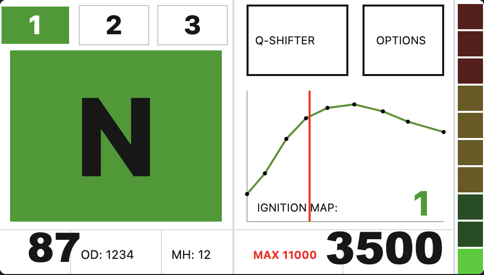
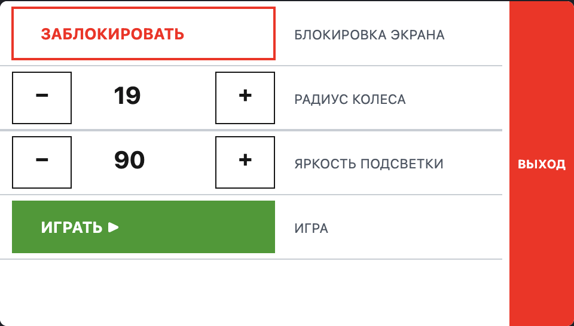
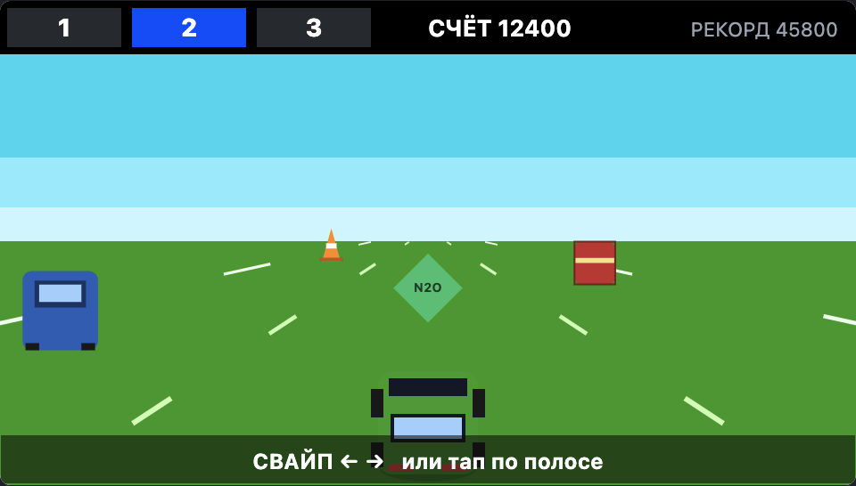
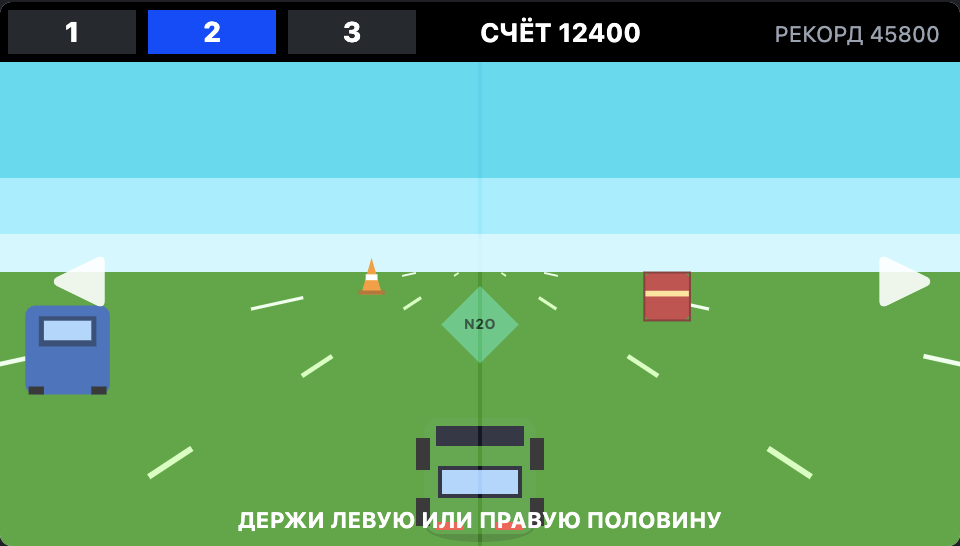
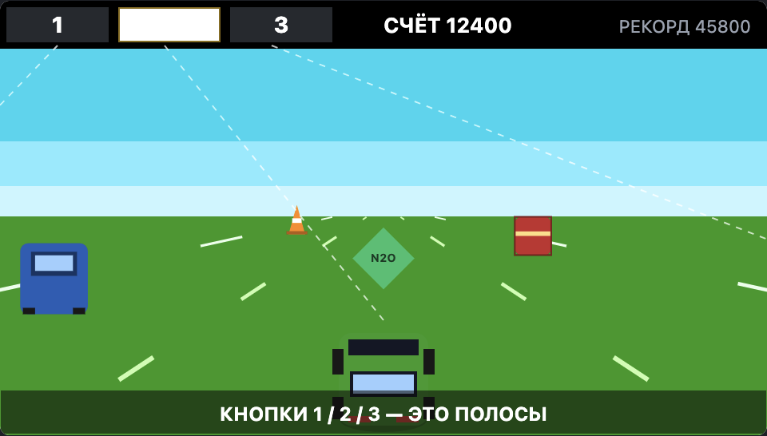
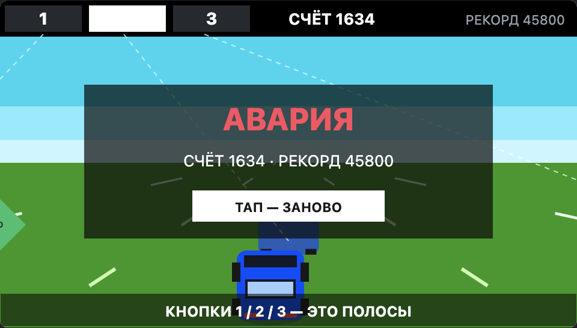

# DED CORE VISION

[](https://github.com/RazdoruNET/DED_CORE_VISION/actions/workflows/build.yml)

Дисплей-модуль приборки для **[DED CORE V4](https://github.com/RazdoruNET/DED_CORE_V4)**.
Плата — **JC4827W543**: ESP32-S3-N4R8, 4.3″ TFT 480×272 (NV3041A, QSPI), ёмкостный тач GT911.

Модуль подключается к точке доступа ядра как обычный клиент, читает телеметрию по WebSocket
и показывает приборку: карту зажигания, тахометр, передачу, скорость, одометр и моточасы.
Внутри — игра «дорога» из заводской прошивки, дополненная препятствиями и бонусами.



---

## Экраны

### Приборка

- три кнопки карт (1 / 2 / 3) — переключение карты на ядре;
- Q-SHIFTER — включение/выключение квикшифтера;
- OPTIONS — настройки;
- карта зажигания: угол от оборотов, красная линия — текущие обороты;
- тахометр из 10 ячеек, MAX и большие обороты;
- передача (N / 1…6), скорость, OD (одометр), MH (моточасы);
- при потере связи — плашка «DED BOX OFFLINE».

### Настройки



| Пункт | Что делает |
|---|---|
| Блокировка экрана | блокирует касания, разблокировка — удержание 1 с |
| Радиус колеса | 10…30, пересчёт длины окружности и одометра |
| Яркость подсветки | 10…100 % |
| Игра | запуск игры |
| Портал настройки / ИНФО / Ч/Б | точка доступа портала, диагностика, инверсия темы |

### Игра

Вход: **OPTIONS → ИГРА → ТАП — СТАРТ**. Выход: красный `X` в правом верхнем углу.
Дорога, счёт и `SPEED UP` — заводской `game()`; машина рисуется в её блоке `mot_x/mot_y` в цвете полосы, препятствия едут по центрам этих полос.



Три полосы, препятствия едут навстречу и растут по перспективе. Верхняя панель — те же
три кнопки 1/2/3, что и карты на приборке: они выбирают полосу. Свайп влево/вправо работает
как дубль.

| Свайп | Удержание половины | Кнопки карт |
|---|---|---|
|  |  |  |

**Препятствия:** конус, бочка, встречная машина, блок, лужа — столкновение заканчивает заезд.
**Бонусы:** N₂O (+250 и удвоение счёта на пару секунд), монета (+100).
Скорость и частота препятствий растут; минимум одна полоса всегда остаётся свободной.
Рекорд хранится в NVS и переживает перезагрузку.



> Скриншоты — макеты экранов (браузерный прототип с теми же координатами и палитрой).
> Итоговый вид на панели зависит от шрифтов U8g2 и подстраивается по месту.

---

## Железо

| Назначение | GPIO |
|---|---|
| Дисплей NV3041A: CS / SCK / D0 / D1 / D2 / D3 | 45 / 47 / 21 / 48 / 40 / 39 |
| Подсветка | 1 |
| Тач GT911: SDA / SCL / RST / INT | 8 / 4 / 38 / 3 |
| КПП: нейтраль / 1 / 2 / 3 / 4 / 5 / 6 | 18 / 17 / 16 / 14 / 5 / 15 / 6 |
| Реле квикшифтера | 9 |
| Датчик скорости | 7 |

Пины не меняются относительно заводской платы: прошивка ставится на готовое неразборное железо.
Квикшифтер и передачи обрабатываются локально, как в оригинале.

## Как это работает

1. **Сопряжение.** Ядро по команде из приложения на 3 минуты поднимает сеть `DED_PAIR_*`,
   закрытую WPA2-кодом. Код показывается в приложении, владелец вводит его в портале модуля.
   Модуль подключается с этим кодом, забирает `GET /module/pair` (ssid, пароль, адрес, порт,
   токен) с заголовком `X-Module-Mac` и сохраняет в NVS.
2. **Телеметрия.** Модуль подключается к точке доступа ядра и держит WebSocket на порту 81.
   Кадр `{"event":"message","data":{…}}` приносит `card`, `rpm`, `max_rpm`, `angles`, `type`,
   `throttle`, `init_angle`, `servo*`. Свежесть кадра — 3 секунды.
3. **Доверенный модуль.** После подключения отправляется `module_hello` с токеном. Ядро отвечает
   `{"trusted":1}` и присылает `module_credentials` при смене имени/пароля точки доступа.
4. **Портал.** Если модуль не настроен или потерял ядро — точка доступа `DED_CORE_VISION`
   с паролем, который модуль показывает на экране при открытии портала (10 секунд),
   страница `http://192.168.5.1/`, запуск сопряжения, проверка дисплея и OTA с паролем.
5. **Автоматика.** Потеря связи → повтор подключения каждые 20 с; через 60 с — поиск **своего**
   ядра по сохранённому BSSID; после 10 неудачных стартов — портал.

## Сборка и прошивка

```bash
pio run                 # сборка
pio run -t upload       # прошивка
pio device monitor      # лог, 115200
```

Требуется PlatformIO Core и `espressif32@7.0.1` (Arduino core 2.0.17). Память: 4 МБ flash,
8 МБ OPI PSRAM; таблица разделов `partitions_vision.csv` — два OTA-слота без файловой системы.

Первую прошивку ставят по USB: разметка отличается от заводской. NVS остаётся на
`0x9000`, поэтому настройки не теряются; дальше обновления можно ставить через
портал (`/update`, логин `admin`, пароль печатается в лог при первом запуске).

## Структура

```
src/
  main.cpp              точка входа, сопряжение и цикл сети
  app/State.*           общее состояние UI и телеметрии
  app/Tasks.*           задачи FreeRTOS: тач, КПП, скорость, обороты
  app/Status.h          состояние для портала
  config/               пины, тайминги, версия
  display/              Arduino_GFX Canvas, NV3041A, GT911
  net/                  WebSocket, сопряжение, настройки, портал
  sensors/              передачи, скорость, квикшифтер
  ui/Draw.*             приборка, карта зажигания, настройки, игра
  ui/Game.*             препятствия, бонусы, рекорд
  ui/TouchLogic.*       обработка касаний
docs/screens/           скриншоты экранов
```

## Статус

Порт с `DED_VISION` (Arduino IDE, монолитный `.ino`) на структуру модулей DED CORE V4.
Готовы: сеть и сопряжение, портал, дисплей и тач, приборка, настройки, игра.
Прошивка собирается локально и в GitHub Actions; занято 1,07 МБ из 1,87 МБ OTA-слота.
Дальше — прогон на железе, подгонка шрифтов и проверка квикшифтера на реальном двигателе.

## Ссылки

- [DED CORE V4](https://github.com/RazdoruNET/DED_CORE_V4) — ядро системы зажигания
- [DED CORE LED](https://github.com/RazdoruNET/DED_CORE_LED) — модуль индикации карты
- [DED CORE SERVO](https://github.com/RazdoruNET/DED_CORE_SERVO) — модуль привода
- [Плата JC4827W543](https://github.com/profi-max/JC4827W543_4.3inch_ESP32S3_board)
